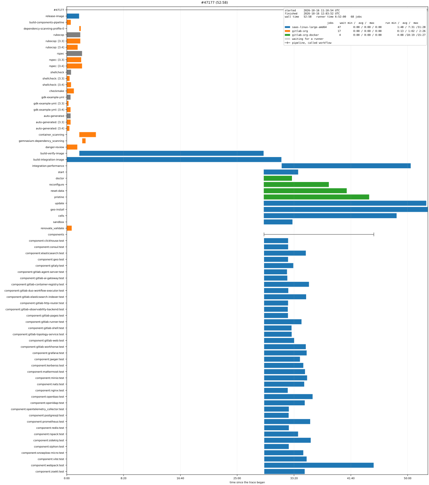

.. _VIS/PipelineTrace:

Pipeline Trace Diagram
######################

A pipeline read into a **trace** - a timespan for the pipeline, every matrix, downstream pipeline and job - is written
as OpenTelemetry's OTLP/JSON, which trace viewers read, or drawn as a Gantt chart.

.. contents:: Contents of this page
   :local:
   :depth: 1

.. _VIS/PipelineTrace/Reading:

Reading a Pipeline
******************

:class:`~pyTooling.GitLab.Tracing.PipelineReader` reads a pipeline through the GitLab REST API, using the standard
library only:

.. code-block:: python

   from os import getenv
   from pathlib import Path
   from pyTooling.GitLab.Tracing import PipelineReader

   reader = PipelineReader("gitlab-org/gitlab-development-kit", token=getenv("GITLAB_TOKEN"))
   trace = reader.ReadPipeline(2954836704)      # optionally: downstream=False
   trace.WriteOTLPJSONFile(Path("report/Pipeline.otlp.json"))

The project is given by its path or its numeric identifier. A public project's pipelines are read without a token; a
private project's need one with the ``read_api`` scope. A self-managed GitLab instance is reached with
``apiURL="https://gitlab.example.com/api/v4"``.

The reader reads the pipeline, its jobs, its trigger jobs and - unless ``downstream=False`` - the child pipelines
those started, with their own child pipelines. A multi-project pipeline belongs to another project, so it is a
timespan of its trigger job without contents. :meth:`~pyTooling.GitLab.Tracing.PipelineReader.ReadPayloads` returns
the payloads instead of the trace, in the shape :meth:`Pipeline.Parse <pyTooling.GitLab.Pipeline.Parse>` takes them,
e.g. to store them for later.

A request failing transiently - HTTP 429, 500, 502, 503 or 504, a timeout, or an unreachable API - is tried again,
``retries`` times (default: 3), after a pause of ``retryDelay`` seconds (default: 2), which doubles with every attempt
or lasts as long as a ``Retry-After`` header demands, up to a minute. HTTP 401, 403 and 404 fail at once. GitLab
answers a list - the jobs, the trigger jobs - as a JSON array, which
:class:`~pyTooling.GitLab.ProjectClient` reads page by page.

:meth:`PipelineTrace.Parse <pyTooling.GitLab.Tracing.PipelineTrace.Parse>` does the conversion alone, for payloads
that were fetched another way. It is a class method, so converting needs no reader and therefore no token. It reads
the payloads into a :class:`~pyTooling.GitLab.Pipeline` - see :ref:`DATA/PipelineRun` - and hands that to
:meth:`~pyTooling.GitLab.Tracing.PipelineTrace.FromPipeline`, which is the entry point when the model was built
elsewhere. Reading the payloads is therefore the model's job, and a field GitLab doesn't document raises
:exc:`~pyTooling.GitLab.GitLabError` - as does an answer the reader itself can't read, so everything GitLab says that
can't be made sense of is one exception type. A request that *fails* is a :exc:`~pyTooling.REST.RESTError`, because
nothing about GitLab's answer was wrong - there wasn't one.

.. _VIS/PipelineTrace/Timespans:

Timespans and Attributes
************************

The pipeline becomes the trace, and every timespan below it is marked by :attr:`~pyTooling.Tracing.CI.CI.Span.Kind`
with a member of :class:`~pyTooling.Tracing.CI.SpanKind`. Each kind is a class of its own - a
:class:`~pyTooling.Tracing.CI.JobSpan` sets ``ci.span.kind`` to ``job`` because that is what it is, and takes the
attributes of a job as parameters - so a reader states values and never a key, and the readers of GitLab and GitHub
build the same classes:

+--------------+------------------------------------------------------------------------------------------------------+
| Kind         | Timespan                                                                                             |
+==============+======================================================================================================+
| ``pipeline`` | The pipeline, from its start to its end.                                                             |
+--------------+------------------------------------------------------------------------------------------------------+
| ``workflow`` | A downstream pipeline: the jobs of a child pipeline are grouped below a timespan named like the      |
|              | trigger job.                                                                                         |
+--------------+------------------------------------------------------------------------------------------------------+
| ``matrix``   | A matrix: the jobs named ``rspec: [3.4]`` or ``test 2/4`` are grouped below a timespan ``rspec``     |
|              | respectively ``test``.                                                                               |
+--------------+------------------------------------------------------------------------------------------------------+
| ``queued``   | ``<job> (queued)``, the time GitLab reports a job was queued for a runner, in front of the job.      |
+--------------+------------------------------------------------------------------------------------------------------+
| ``job``      | A job, from its start to its completion.                                                             |
+--------------+------------------------------------------------------------------------------------------------------+

Every timespan also carries the attributes of OpenTelemetry's semantic conventions for CI/CD, which
:class:`~pyTooling.Tracing.CI.OTLP` names as a namespace nested the way the keys are. The values a result may take are
:class:`~pyTooling.Tracing.CI.Result`, which are those of the model's :class:`~pyTooling.CI.Outcome`, so a result is
the element's outcome. What only GitLab reports is named the same way by :class:`~pyTooling.GitLab.Tracing.GitLab`,
e.g. ``gitlab.status`` beside the result it was mapped to, a job's ``gitlab.job.stage``, and the
``gitlab.runner.tags`` it requested its runner by. A matrix instance lists the values it was produced for in
``gitlab.matrix.dimensions``. A downstream pipeline carries its own identifier, URL and result as the task's, and its
trigger job's in ``gitlab.trigger.*``.

A task is named the way GitLab's tree reads - ``components / component:redis:test`` - while the timespan itself is
named by the part the model holds, so a timespan reads in the context its parents already give.

What differs from a GitHub Actions run, follows from what GitLab reports:

* **A job's waiting timespan is the time GitLab reports it was queued**, right in front of its start. GitLab creates
  every job of a pipeline with the pipeline, so the time between a job's creation and its start is mostly the time it
  waited for the jobs it depends on - which isn't waiting for a runner.
* **A job has no steps**, so a job's timespan has no sub-spans.
* A job that hasn't started - e.g. one waiting to be started by hand - has no timespan, and neither has a matrix
  holding only such jobs. A skipped job lasts no time, placed at the moment it was skipped.
* A group - a matrix, a downstream pipeline, the trace itself - begins when it or the first job below it started, or
  earlier, when a job was queued for a runner before. GitLab reports the time in milliseconds and the queued time as a
  duration, so a waiting timespan reaching before its parent is cut at the parent's begin.
* A downstream pipeline reports its own times. One whose payloads weren't read - a multi-project pipeline - has no
  start, and spans its creation to its completion; one a trigger job hasn't started yet has no timespan.

.. _VIS/PipelineTrace/Gantt:

Gantt Chart
***********

pyTooling lays a trace out as a Gantt chart and draws it with matplotlib - see
:external+pyTool:ref:`pyTooling's rendering <TRACING/Render>`. :func:`~pyTooling.Tracing.Render.ciSpanFilter`
selects what a pipeline's chart shows, and :func:`~pyTooling.GitLab.Tracing.runnerCategory` colors a job by its
runner:

.. code-block:: python

   from pyTooling.GitLab.Tracing            import runnerCategory
   from pyTooling.Tracing.Render            import GanttLayout, ciSpanFilter
   from pyTooling.Tracing.Render.Matplotlib import MatplotlibRenderer

   layout = GanttLayout(trace, spanFilter=ciSpanFilter(), categorize=runnerCategory)
   MatplotlibRenderer(layout).Write(Path("report/Pipeline.svg"))

* A row per job, below the rows of the matrix and the downstream pipeline it belongs to. The time a job was queued is
  drawn in light gray in front of the time it ran, colored per runner: its first tag, e.g.
  ``saas-linux-large-amd64``, or the runner's description for a job without tags.
* The legend carries the statistics per runner: the number of jobs, and the shortest, average and longest waiting and
  running times.
* Skipped jobs are left out, unless ``excludeSkippedJobs=False``.
* ``MatplotlibRenderer(layout, collapsible=True)`` writes an SVG file whose rows of downstream pipelines and matrices
  can be collapsed and expanded with a click.

The drawing needs the extra ``diagram`` (see :ref:`DEP/diagram`).

   A merge request pipeline of the GitLab Development Kit
   (`pipeline 2954836704 <https://gitlab.com/gitlab-org/gitlab-development-kit/-/pipelines/2954836704>`__), drawn as
   above from the recorded payloads in :file:`tests/data/Runs/GitLabDevelopmentKit.json`.
